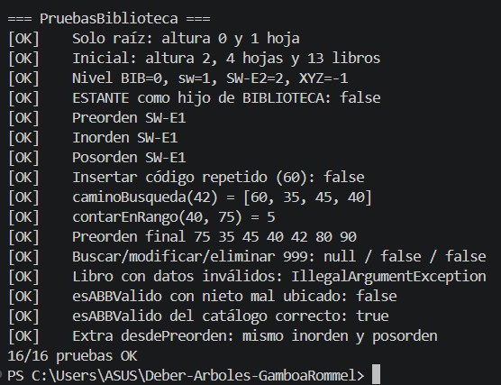

# Deber APE 3 · Catálogo de la Biblioteca FISEI con árbol general y ABB

**Estudiante:** Rommel Gamboa · **Asignatura:** Estructura de Datos · **Nivel:** Tercero – Software (FISEI-UTA)

## Problema

La Biblioteca FISEI se organiza en **Áreas** y cada Área en **Estantes**. Esa jerarquía se representa con un
**árbol general n-ario** (`BIBLIOTECA → AREA → ESTANTE`). Cada Estante guarda sus libros en un
**Árbol Binario de Búsqueda (ABB)** ordenado por el código del libro (entero positivo, sin repetidos).

```
BIB Biblioteca FISEI
├── SW Software
│   ├── SW-E1 Estante 1 de Software → 60, 35, 80, 20, 45, 70, 90, 40, 75
│   └── SW-E2 Estante 2 de Software → 15, 10, 25
├── TI Tecnologías de la Información
│   └── TI-E1 Estante 1 de TI → 50
└── TEL Telecomunicaciones
```

7 unidades, 4 hojas, altura 2 (en aristas) y 13 libros.

## Estructura del proyecto

```
src/
├── enums/    TipoUnidad.java, TipoRecorrido.java
├── modelo/   Libro.java, UnidadBiblioteca.java
├── negocio/  NodoUnidad.java, NodoLibro.java, ArbolBiblioteca.java, CatalogoABB.java
└── app/      Main.java, DatosPrueba.java, PruebasBiblioteca.java
```

Capas en un solo sentido: `app → negocio → modelo → enums`.

| Clase | Responsabilidad |
|---|---|
| `TipoUnidad` | Niveles de la jerarquía y la regla `puedeTenerHijo` (solo el tipo inmediato inferior). |
| `Libro` | Código (> 0, sin setter), título, autor y año (1900–2026) con validaciones. |
| `UnidadBiblioteca` | Código en mayúsculas, nombre y tipo. |
| `NodoUnidad` | Dato, lista de hijos y un `CatalogoABB` solo si es ESTANTE. |
| `NodoLibro` | Dato, izquierdo y derecho. |
| `ArbolBiblioteca` | agregar, buscar, altura, contarHojas, nivel, mostrarJerarquia, contarLibrosTotal. |
| `CatalogoABB` | insertar, buscar, contar, recorrer, trazaRecorrido, modificar, eliminar y los retos. |

Todas las operaciones de los árboles son **recursivas**: cada método público valida y delega en un método
privado con caso base `nodo == null` (o el nodo buscado). No se usa `TreeSet`, `TreeMap`, `PriorityQueue`,
`NavigableSet`, `NavigableMap`, `Collections.sort` ni `List.sort`.

### Retos (Parte D)

| Método | Idea |
|---|---|
| `contarEnRango(a, b)` | Si el código es menor que `a` solo baja a la derecha; si es mayor que `b`, solo a la izquierda (poda). |
| `caminoBusqueda(codigo)` | Guarda cada código visitado mientras baja como en una búsqueda. |
| `esABBValido()` | Cada nodo recibe un mínimo y un máximo; al bajar a la izquierda el máximo pasa a ser el nodo, a la derecha el mínimo. |
| `desdePreorden(int[])` (extra) | Reconstruye el ABB en O(n) usando límites: el primer código es la raíz y los siguientes caen a su izquierda mientras sean menores. |

## Cómo ejecutar

Desde la carpeta del proyecto, en PowerShell:

```powershell
Get-ChildItem -Recurse src -Filter *.java | ForEach-Object { $_.FullName } | Set-Content sources.txt
javac -encoding UTF-8 -d out '@sources.txt'
java -cp out app.PruebasBiblioteca     # casos de prueba
java -cp out app.Main                  # menú interactivo
```

En Linux/macOS: `javac -encoding UTF-8 -d out $(find src -name "*.java")`.

## Pruebas

`PruebasBiblioteca` ejecuta los casos obligatorios del enunciado (y el extra) y muestra `16/16 pruebas OK`.



## Trazas a mano

Ver [`TRAZAS.md`](TRAZAS.md).
