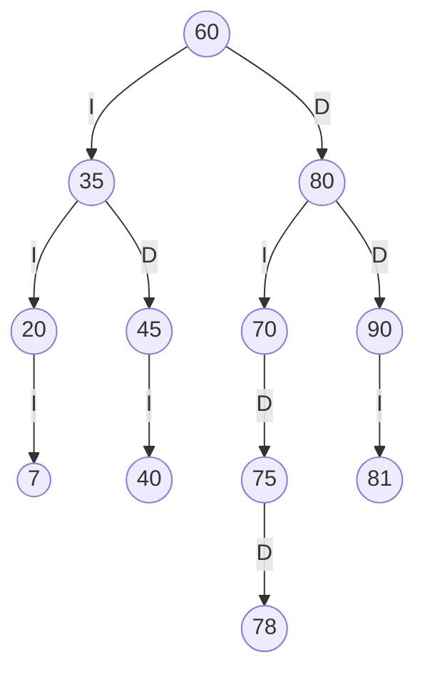
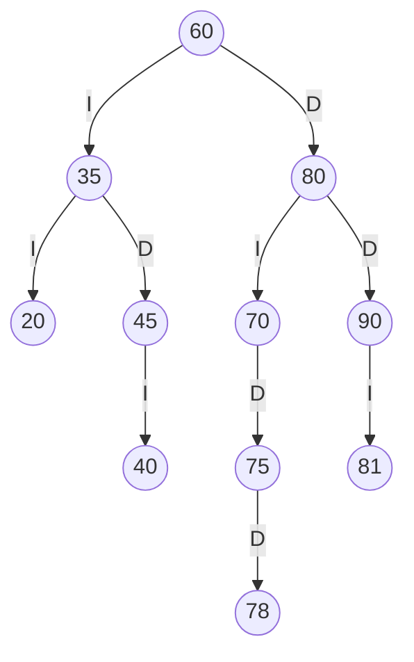
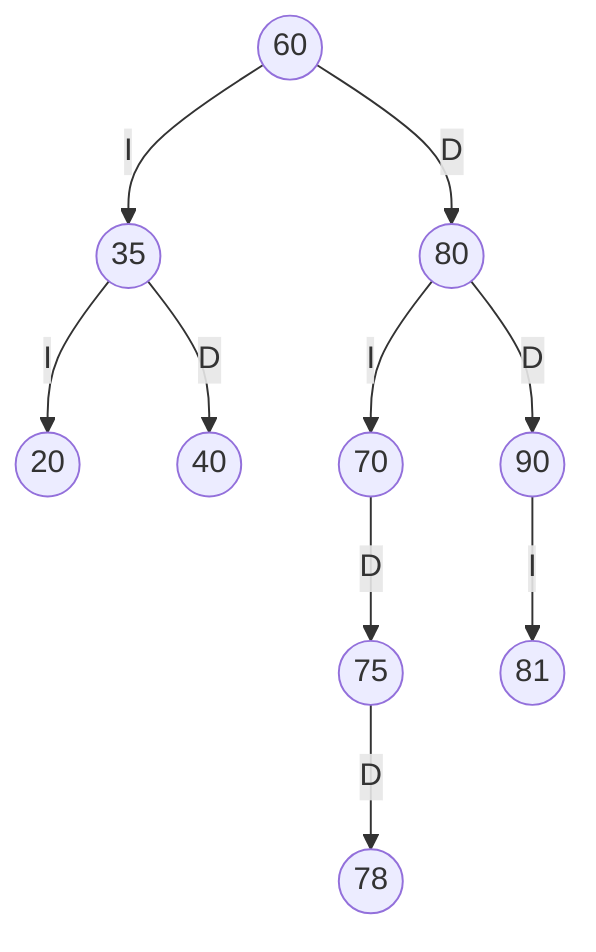
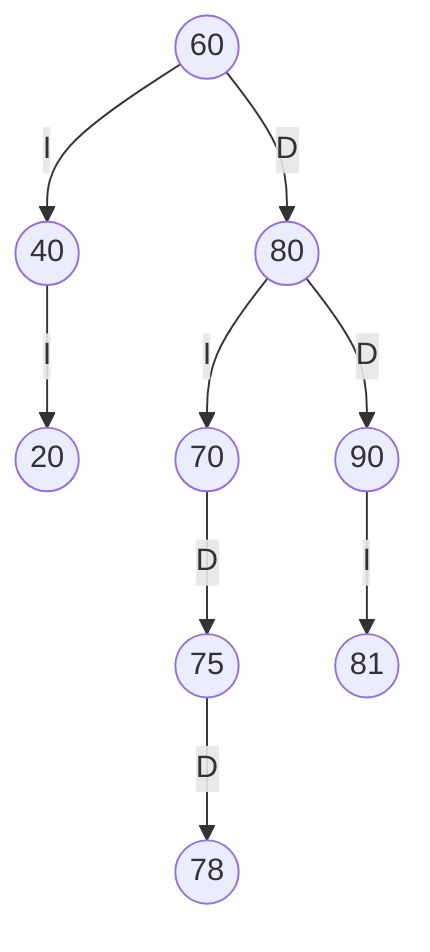

# TRAZAS.md · Deber APE 3 · Biblioteca FISEI

Resuelto a mano y comparado con la salida del programa (`app.Main`).

## 1. Códigos personales

Últimos 4 dígitos de la cédula: **8078** (a=8, b=0, c=7, d=8). Regla: si un código es 0, se repite o ya existe en SW-E1, se le suma 1.

| Código | Dígitos | Valor usado | Nota |
|---|---|---|---|
| ab | 80 | 81 | 80 ya existe: se suma 1 hasta que no exista |
| bc | 07 | 7 | sin cambio |
| cd | 78 | 78 | sin cambio |

Códigos personales: **81, 7, 78**.

## 2. Inserción

Secuencia insertada en SW-E1: `60, 35, 80, 20, 45, 70, 90, 40, 75` y luego `81, 7, 78`.

| Código | Camino desde la raíz | Queda como |
|---|---|---|
| 81 | 60 → 80 → 90 → (vacío) | hijo izquierdo de 90 |
| 7 | 60 → 35 → 20 → (vacío) | hijo izquierdo de 20 |
| 78 | 60 → 80 → 70 → 75 → (vacío) | hijo derecho de 75 |

## 3. ABB final



## 4. Recorridos

| Recorrido | A mano | Programa | Resultado |
|---|---|---|---|
| Preorden | 60 35 20 7 45 40 80 70 75 78 90 81 | 60 35 20 7 45 40 80 70 75 78 90 81 | ✅ Coincide |
| Inorden | 7 20 35 40 45 60 70 75 78 80 81 90 | 7 20 35 40 45 60 70 75 78 80 81 90 | ✅ Coincide |
| Posorden | 7 20 40 45 35 78 75 70 81 90 80 60 | 7 20 40 45 35 78 75 70 81 90 80 60 | ✅ Coincide |

## 5. Traza del preorden

A mano:

```
entra 60
VISITA 60
  entra 35
  VISITA 35
    entra 20
    VISITA 20
      entra 7
      VISITA 7
        null -> regresa
        null -> regresa
      null -> regresa
    entra 45
    VISITA 45
      entra 40
      VISITA 40
        null -> regresa
        null -> regresa
      null -> regresa
  entra 80
  VISITA 80
    entra 70
    VISITA 70
      null -> regresa
      entra 75
      VISITA 75
        null -> regresa
        entra 78
        VISITA 78
          null -> regresa
          null -> regresa
    entra 90
    VISITA 90
      entra 81
      VISITA 81
        null -> regresa
        null -> regresa
      null -> regresa
Secuencia PREORDEN: 60 35 20 7 45 40 80 70 75 78 90 81
```

Salida del programa (opción 10, PREORDEN):

```
entra 60
VISITA 60
  entra 35
  VISITA 35
    entra 20
    VISITA 20
      entra 7
      VISITA 7
        null -> regresa
        null -> regresa
      null -> regresa
    entra 45
    VISITA 45
      entra 40
      VISITA 40
        null -> regresa
        null -> regresa
      null -> regresa
  entra 80
  VISITA 80
    entra 70
    VISITA 70
      null -> regresa
      entra 75
      VISITA 75
        null -> regresa
        entra 78
        VISITA 78
          null -> regresa
          null -> regresa
    entra 90
    VISITA 90
      entra 81
      VISITA 81
        null -> regresa
        null -> regresa
      null -> regresa
Secuencia PREORDEN: 60 35 20 7 45 40 80 70 75 78 90 81
```

Resultado: ✅ Coincide.

## 6. Eliminaciones

### 6.1 Eliminar 7 (hoja)

Caso hoja.



Preorden: 60 35 20 45 40 80 70 75 78 90 81 · Inorden: 20 35 40 45 60 70 75 78 80 81 90

### 6.2 Eliminar 45 (un hijo)

Caso un hijo.



Preorden: 60 35 20 40 80 70 75 78 90 81 · Inorden: 20 35 40 60 70 75 78 80 81 90

### 6.3 Eliminar 35 (dos hijos)

Caso dos hijos. Sube su sucesor inorden: 40.



Preorden: 60 40 20 80 70 75 78 90 81 · Inorden: 20 40 60 70 75 78 80 81 90

### Comparación con el programa (opción 9 y luego opción 10)

| Recorrido final | A mano | Programa | Resultado |
|---|---|---|---|
| Preorden | 60 40 20 80 70 75 78 90 81 | 60 40 20 80 70 75 78 90 81 | ✅ Coincide |
| Inorden | 20 40 60 70 75 78 80 81 90 | 20 40 60 70 75 78 80 81 90 | ✅ Coincide |
